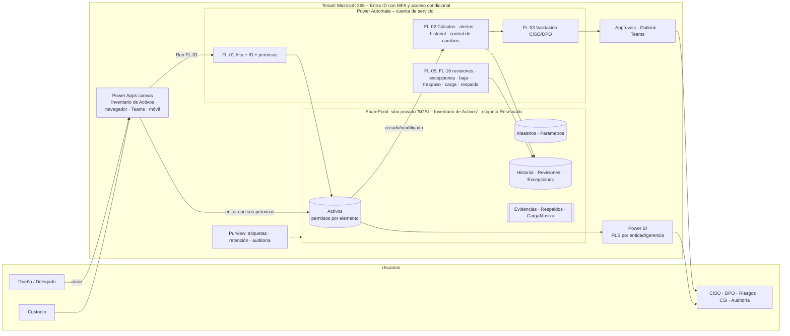
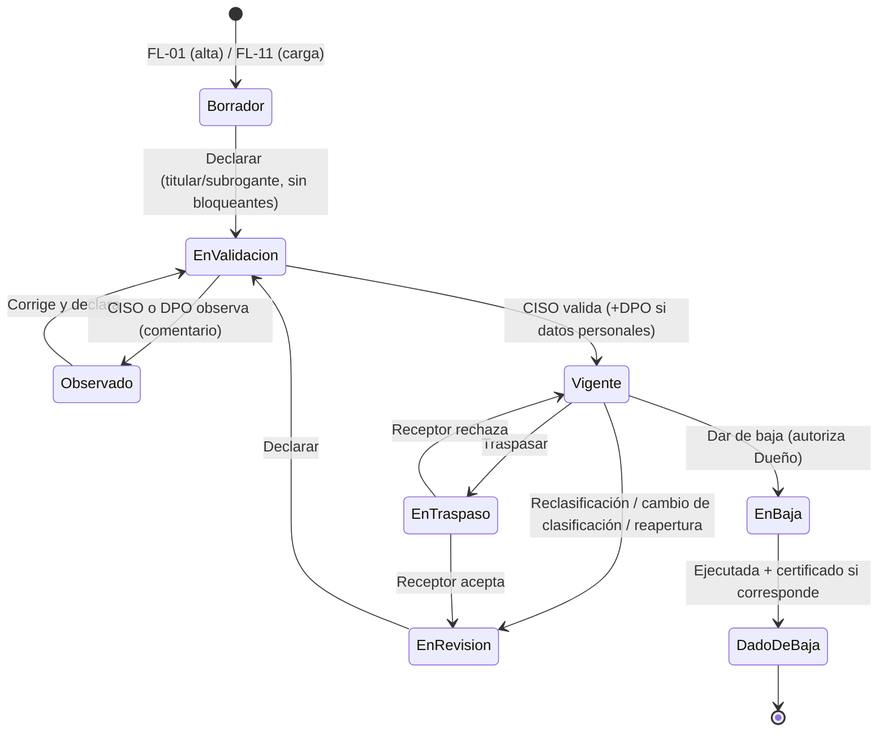

# 01 · Diseño de la solución

**Documento base:** ER[ZZ].GR_1.0(2026) – Especificación de Requerimientos, Solución de Inventario y Clasificación de Activos de Información (v1.0, nov-2026).
**Escenario de licenciamiento implementado:** A (Microsoft 365 E3, conectores estándar) + Power BI Pro para roles de consulta, según la recomendación de la sección 5.3.
**Clasificación de este documento:** Uso Interno (describe controles; no contiene datos del inventario).

## 1. Arquitectura

| Capa | Componente | Requerimientos principales |
|---|---|---|
| Datos | Sitio SharePoint privado sin grupo M365, 15 listas + 3 bibliotecas (`config/*.json`) | RF-01 a RF-15, RF-35, RNF-01, RNF-06, RNF-09 |
| Presentación | App canvas con asistente de 5 pasos, ficha, bandejas, revisiones, excepciones y administración (`powerapps/`) | RF-06 a RF-22, RF-26, RF-30, RF-40, RF-48, RNF-12, RNF-13 |
| Lógica | 16 flujos (`powerautomate/`) ejecutados por la cuenta de servicio | RF-07, RF-17 a RF-41, RF-45, RF-50, RNF-04, RNF-08 |
| Reportería | Power BI con RLS (`powerbi/`) | RF-42, RF-43 |
| Identidad y cumplimiento | Grupos Entra ID, etiquetas y retención Purview, DLP de Power Platform (`scripts/01`, `purview/`, `scripts/09`) | RNF-02, RNF-05, RNF-16, RF-46, RF-49 |
| Aseguramiento | Especificación ejecutable de reglas (`tests/`), validación de configuración (`tools/`), CAAT de controles (`scripts/08`) | RN-01 a RN-16, sección 16 |

## 2. Fuente única de verdad

`config/catalogo-campos.json` define los 61 campos del Catálogo V1.0 (Anexo A, incluido F61 Entidad – D-07) más 23 columnas técnicas. De él se derivan: la creación de columnas (`scripts/03`), la plantilla de carga y su mapeo (`tools/build_plantilla_carga.py`), la validación previa (`scripts/06`) y la ayuda contextual de la app. Las reglas de negocio viven en `tests/reglas/reglas.js` (con 23 pruebas automatizadas) y se replican en tres capas: Power Fx (`App.Formulas.fx`, experiencia de usuario), Power Automate (`FL-02b`, control efectivo) y PowerShell (`RNInventario.Reglas.psm1`, validación de cargas y CAAT). `npm run validar` verifica que los 20 códigos de alerta estén implementados en las tres capas.

## 3. Modelo de seguridad (sección 13)

1. **Acceso solo por grupos de Entra ID.** Transversales (`SGSI-INV-CISO`, `-DPO`, `-RIESGOS`, `-CSI`, `-AUDITORIA`, `-CUSTODIOS`, `-ADMIN-TI`, `-PERSONAS`) y uno de edición por gerencia (`SGSI-INV-<ENT>-<GER>-EDIT`).
2. **Activos con permisos únicos por elemento**: edición para la gerencia dueña (y la contraparte si es *Ambas*), el CISO y el Custodio; lectura para DPO, Riesgos, CSI y Auditoría. Nivel de permiso propio *SGSI Editar sin eliminar* (los activos no se borran: se dan de baja).
3. **Nadie crea elementos directamente.** A nivel de lista solo tienen acceso el CISO y la cuenta de servicio; el alta la hace FL-01, que crea el elemento y le asigna permisos en la misma ejecución. *Mejora respecto del ER:* en el diseño original (flujo disparado tras la creación) el elemento hereda los permisos de la lista durante segundos o minutos, lo que expondría borradores de una entidad a la otra (incumpliría CA-02).
4. **Columnas protegidas** (calculadas, de estado y de validación): SharePoint no ofrece seguridad por columna; FL-02 paso 2 revierte cualquier cambio directo y lo registra como *Cambio no autorizado revertido* (control detectivo-correctivo, con evidencia). Lo mismo para cambios de clasificación hechos por un Custodio.
5. **Flujos instantáneos con cuenta de servicio** validan la identidad del invocador desde el encabezado del disparador (no desde parámetros de la app) y su pertenencia a grupos.
6. **Segregación de funciones**: solo el titular/subrogante del cargo Dueño declara (RF-26); quien declara queda excluido de la aprobación CISO; la cuenta de servicio es la única que escribe en bitácoras; Admin TI no está en los grupos de datos del sitio.
7. **Power BI** replica la regla con RLS desde `PertenenciaGrupos` (FL-15).
8. **Sitio**: sin uso compartido externo, sin solicitudes de acceso, solo propietarios comparten, etiqueta *Reservado* (privado, sin invitados, acceso limitado en dispositivos no administrados), retención 5 años.

## 4. Decisiones de diseño respecto del ER (para aprobación del CSI)

| # | Tema | ER v1.0 | Implementación | Motivo |
|---|---|---|---|---|
| DD-01 | Alta de activos | Flujo FL-01 disparado al crear el elemento | La app invoca FL-01, que crea el elemento con la cuenta de servicio | Evita la ventana de exposición entre entidades (RNF-03, CA-02) |
| DD-02 | Lista Revisiones | Permisos por elemento | Bitácora con lectura transversal; el Dueño revisa desde la ficha del activo | Cada revisión con permisos únicos duplicaría o triplicaría el consumo del límite de 5.000 elementos con permisos únicos (RNF-11) |
| DD-03 | Historial para el Dueño | Lista Historial de lectura transversal | Además, resumen de los últimos 20 eventos en el propio activo | Cumple RF-35 sin abrir la bitácora de ambas entidades a todos los Dueños |
| DD-04 | Columnas de persona/búsqueda | Dueño, Custodio, Declarante, Receptor como búsqueda/persona | `RN_DeclaradoPor`, `RN_CustodioPersona` como UPN texto; `RN_CargoReceptor` como número | Umbral de 12 columnas de búsqueda por consulta de SharePoint (quedan 11) |
| DD-05 | Columnas calculadas | — | Todas escritas por FL-02b; columnas *protegidas* revertidas si se editan a mano | Las fórmulas de SharePoint no usan la fecha actual (§5.2) y no hay seguridad por columna |
| DD-06 | Revisiones/campañas | Lista Revisiones con tareas | Las campañas se derivan de `RN_ProximaRevision` (indexada) y se confirman en lote desde la app | Consultas delegables y sin permisos únicos adicionales |
| DD-07 | Exportación (RF-44) | Power Apps + Purview | FL-16 con la **conexión del usuario** sobre plantilla etiquetada *Reservado* + Office Script | En E3 no hay etiquetado automático; la copia conserva la etiqueta; la conexión del usuario garantiza que solo exporta lo que puede ver |
| DD-08 | Carga masiva | FL-11 | Validación previa fuera de línea (`scripts/06`) + FL-11, que reutiliza FL-01 para cada fila | Un único camino de creación (ID, permisos, historial) |

## 5. Hallazgos y nuevas decisiones pendientes

| ID | Hallazgo | Impacto | Propuesta |
|---|---|---|---|
| **D-09** | Las **soluciones** de Power Platform (RNF-14: DEV/TEST/PROD, variables de entorno y referencias de conexión) requieren entornos **con Dataverse**. Las licencias M365 E3 no otorgan por sí solas capacidad de Dataverse al tenant; crear entornos TEST/PROD con base de datos puede no ser posible sin capacidad adquirida. | Bloquea RNF-14 y CA-12 si no hay capacidad | TI confirma la capacidad disponible en el centro de administración (F0). Alternativas: (a) DEV como *entorno de desarrollador* (gratuito) + TEST/PROD con capacidad mínima (1 GB c/u); (b) si no hay capacidad, operar en el entorno predeterminado con exportación de paquetes y un procedimiento de reconfiguración documentado (CA-12 no se cumpliría). Los usuarios **no** requieren licencia Premium: la app solo usa conectores estándar y Dataverse actúa como contenedor de la solución. |
| D-10 | El conector Approvals no permite exigir comentario al rechazar. | RF-24 | FL-03 crea una segunda aprobación si el rechazo llega sin comentario (implementado). Aceptar como control compensatorio. |
| D-11 | `REGLAS_MANEJO` y `METODO_BAJA_POR_NIVEL` se redactaron a partir de RN-11 y la estructura del Anexo 1 de la Norma de Clasificación, cuyo texto no se tuvo a la vista. | RF-22, RN-11 | CISO reemplaza los textos por los oficiales en la lista Parámetros (sin cambiar código). |
| D-12 | Retención de la auditoría unificada en E3: 180 días. | RF-49 | Ya mitigado por RNF-07 (Historial propio, 5 años). Evaluar Audit (Premium) si Auditoría Interna requiere logs de acceso de más de 180 días. |
| D-13 | Los activos *Ambas* obtienen la contraparte por gerencia; si un activo compartido involucra **más de dos** gerencias, el modelo actual solo admite una contraparte. | RN-13 | Si ocurre, agregar una columna de búsqueda múltiple de gerencias adicionales (consume 1 de las 12 búsquedas: quedarían 12). |
| D-14 | Escalabilidad: con 10.000 activos se superan los 5.000 elementos con permisos únicos recomendados. | RNF-11 | FL-12 monitorea el conteo y alerta a los 4.000. Umbral alcanzado → dividir `Activos` por entidad (permisos a nivel de lista para RNSG/RNSV y elemento solo para *Ambas*) o migrar al escenario C. |

## 6. Licenciamiento verificado (D-01)

| Capacidad | E3 | Observación |
|---|---|---|
| SharePoint, Power Apps y Power Automate con conectores estándar | ✔ | Todos los conectores usados son estándar: SharePoint (incl. *Enviar solicitud HTTP a SharePoint*), Outlook, Teams, Approvals, Office 365 Users, Office 365 Groups, Excel Online (Business, incl. *Ejecutar script*), OneDrive |
| Entra ID P1 (acceso condicional) | ✔ | Incluido en M365 E3 |
| Etiquetas de sensibilidad manuales y de sitio | ✔ | Automáticas requieren E5/E5 Compliance |
| Power BI | Gratuito | Pro para consumidores (incluido en E5) |
| Dataverse para soluciones | ✘/? | Ver D-09 |

## 7. Ciclo de vida del activo

